<p align="center">
  
</p>

<p align="center">
  <b>José HOUNNAHO</b> · développeur backend, Odoo &amp; IA · Cotonou 🇧🇯<br/>
  <sub>Je code les briques qui manquent pour que le logiciel marche <i>vraiment</i> au Bénin.</sub>
</p>

---

### `$ cat whoami.py`

```python
from odoo import models, fields


class Jocha(models.Model):
    _name = "dev.cotonou"
    _description = "Le hibou qui code la nuit 🦉"

    name     = fields.Char(default="José HOUNNAHO")
    alias    = fields.Char(default="JOCHA")
    location = fields.Char(default="Cotonou, Bénin 🇧🇯")
    roles    = fields.Selection([
        ("backend", "Backend Developer"),
        ("odoo",    "Odoo Developer (17 · 18 · 19)"),
        ("ml",      "ML / DL Developer"),
        ("artist",  "Rap / trap tech, la face B"),
    ])
    mission  = fields.Text(default="""
        Facturer selon la DGI, encaisser en Mobile Money,
        soigner plus vite aux urgences, parler fɔ̀ngbè à la machine.
    """)

    def action_now(self):
        return "Construire des outils africains, pour des usages africains."
```

---

### 🗺️ Les terrains de jeu

<table>
<tr>
<td width="50%" valign="top">

**🏥 Santé & urgences**<br/>
<sub>Identifier un patient inconscient en quelques secondes grâce à la biométrie faciale, et garder les échanges médicaux sécurisés.</sub><br/><br/>
▸ <code>SecureHealth-Net</code> messagerie interne chiffrée et supervision réseau<br/>
▸ <code>biomed-urgences-benin</code> FastAPI · FaceNet · Expo · FHIR <sub>(🔒 en cours)</sub>

</td>
<td width="50%" valign="top">

**🧾 Fiscalité & normalisation**<br/>
<sub>Brancher Odoo sur les machines de facturation normalisée exigées par la DGI.</sub><br/><br/>
▸ <code>eltrade-cc300-driver</code> driver Go du boîtier fiscal Eltrade CC300<br/>
▸ modules Odoo MECEF / e-MCF, factures et avoirs normalisés

</td>
</tr>
<tr>
<td width="50%" valign="top">

**💸 Paiement & commerce**<br/>
<sub>Le Mobile Money comme moyen de paiement natif, partout.</sub><br/><br/>
▸ intégrations Odoo <b>FedaPay</b>, <b>KkiaPay</b>, <b>MTN MoMo</b><br/>
▸ <code>jocha-shop</code> boutiques en ligne pour commerçants béninois, assistant vocal en fɔ̀ngbè <sub>(🔒 en cours)</sub>

</td>
<td width="50%" valign="top">

**🗣️ Langues & expériences**<br/>
<sub>Quand la tech parle nos langues, ou se visite en 3D.</sub><br/><br/>
▸ <code>chatbot-fr-fon</code> chatbot français ⇄ fɔ̀ngbè<br/>
▸ <code>Linux-File-System-Odyssey</code> le système de fichiers Linux en galaxie 3D

</td>
</tr>
</table>

---

### 🧰 La caisse à outils

<p align="center">
  
</p>

<p align="center">
  
  
  
  
  
</p>

<p align="center">
  
  
  
  
</p>

---

### 🎧 Face B

<p align="center">
  
</p>

<p align="center"><sub>Le jour des modules Odoo, la nuit des instrus.</sub></p>

---

### 🐍 Le serpent mange mes commits

<p align="center">
  <picture>
    <source media="(prefers-color-scheme: dark)" srcset="https://raw.githubusercontent.com/jocha28/jocha28/output/snake-dark.svg" />
    
  </picture>
</p>

---

<p align="center">
  <code>🦉 ✕ 🐾</code><br/>
  <sub>Un projet Odoo, une intégration Mobile Money, une idée un peu folle ? Écris-moi, je réponds.</sub>
</p>
