<p align="center">
  
</p>

<h3 align="center">Je code les briques qui manquent pour que le logiciel marche <i>vraiment</i> au Bénin 🇧🇯</h3>

<p align="center">
  
  
  
  
</p>

<br/>

```text
        ,_,          jocha@cotonou
       (O,O)         ─────────────────────────────────────
       (   )         OS ........ Linux, Fedora, café noir
     ───"─"───       Shell ..... bash, gh, docker
                     Langages .. Python · Go · TypeScript · JS · PHP
                     ERP ....... Odoo 17 / 18 / 19 (modules, OWL, localisation)
                     IA ........ PyTorch · TensorFlow · FaceNet · scikit-learn
                     Paiement .. FedaPay · KkiaPay · MTN MoMo
                     Fiscal .... DGI · MECEF · e-MCF · Eltrade CC300
                     Langues ... français · fɔ̀ngbè · anglais
                     Face B .... rap / trap tech 🎧
                     Uptime .... la nuit surtout
```

<br/>

<p align="center">
  
</p>

<br/>

<p align="center">
  
</p>

<br/>

<p align="center">
  
</p>

<br/>

<p align="center">
  <picture>
    <source media="(prefers-color-scheme: dark)" srcset="https://raw.githubusercontent.com/jocha28/jocha28/output/snake-dark.svg" />
    
  </picture>
</p>

<p align="center">
  
</p>
