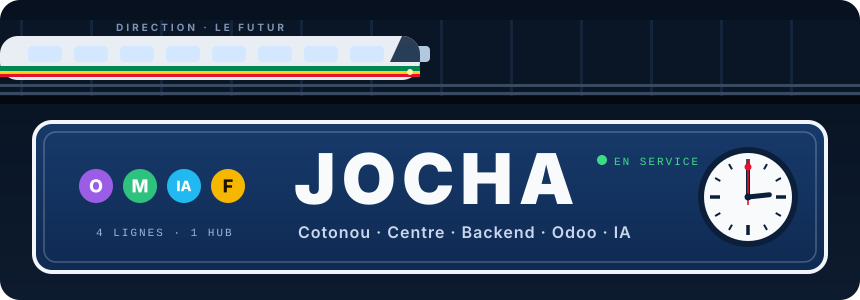

  

  
  
  
  

  <b>Bienvenue à bord du Réseau JOCHA.</b> 
  Je suis <b>José HOUNNAHO</b>, développeur backend, Odoo et IA à Cotonou 🇧🇯. 
  Quatre lignes, une seule correspondance : construire le logiciel qui manque au Bénin.

 

## 🗺️ Plan du réseau

  

<table>
<tr>
<td width="25%" valign="top">

**🟣 Ligne O** 
Odoo 17 · 18 · 19

Modules sur mesure, OWL, localisation béninoise, paie et RH, point de vente. Terminus : la **facture normalisée MECEF**.

</td>
<td width="25%" valign="top">

**🟢 Ligne M** 
Mobile Money

FedaPay, KkiaPay, MTN MoMo branchés sur Odoo et sur le web. Terminus : des **boutiques en ligne** pour les commerçants, avec un assistant vocal en fɔ̀ngbè.

</td>
<td width="25%" valign="top">

**🔵 Ligne IA** 
Vision &amp; NLP

PyTorch, FaceNet, anti-usurpation, dossiers FHIR. Terminus : retrouver le dossier d'un **patient inconscient aux urgences** en quelques secondes.

</td>
<td width="25%" valign="top">

**🟡 Ligne F** 
Face B

Des beats, un studio de nuit, une plateforme musicale. Terminus : le **rap / trap tech** signé JOCHA.

</td>
</tr>
</table>

 

## 🕒 Prochains départs

  

 

## 🚦 Info trafic

> [!NOTE]
> **Trafic fluide sur la ligne O.** Les rames Odoo 17, 18 et 19 circulent normalement, migrations comprises.

> [!TIP]
> **Correspondance garantie à JOCHA · Cotonou.** Toutes les lignes s'y croisent : un module Odoo peut encaisser en Mobile Money et parler à un modèle d'IA.

> [!WARNING]
> **Travaux de nuit sur la ligne IA.** Le hibou 🦉 veille, les commits arrivent surtout entre minuit et 4 h.

> [!IMPORTANT]
> **Nouveau terminus sur la ligne M.** Les boutiques en ligne pour commerçants béninois sont en cours de mise en service.

 

## 🔀 Correspondances

  

  
  
  
  
  
  
  
  
  

 

<b>📜 Règlement du réseau</b> (à lire avant de monter)

 

| Article | Règle |
|:-:|:--|
| 1 | Les tickets sont gratuits. Le café, non. |
| 2 | Il est interdit de pousser en production le vendredi soir. |
| 3 | Toute facture doit être normalisée, même les factures de bonne humeur. |
| 4 | Le paiement en Mobile Money est accepté sur toutes les lignes. |
| 5 | Le fɔ̀ngbè est une langue officielle du réseau. |
| 6 | Le hibou 🦉 a toujours priorité aux heures de nuit. |
| 7 | Sur la ligne F, monter le son est obligatoire. |

 

  

  <picture>
    <source media="(prefers-color-scheme: dark)" srcset="https://raw.githubusercontent.com/jocha28/jocha28/output/snake-dark.svg" />
    
  </picture>
   
  🐍 La ligne S (Serpent) dessert toutes mes contributions, toutes les 12 heures.

